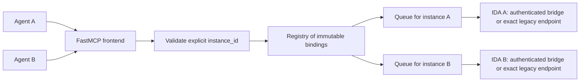

# Explicit instance routing and FastMCP frontend

Date: 2026-10-16

Status: proposed design; source investigation and isolated framework probes completed.
The application changes described here are not implemented yet.

## Outcome and decisions

Multiple agents sharing one MCP connection must be able to analyze different open
IDA databases concurrently. Every database operation names its target in that
request. A request must never follow another agent's selection or execute against
a replacement database that reused a process, path, port, or list position.

The user explicitly chose required `instance_id` arguments and removal of shared
selection, with no legacy selection mode. The user also authorized a framework
change if beneficial and requested inspection of PrefectHQ/FastMCP source.

Recommended design:

- Use FastMCP 4.1.0 for the external MCP frontend, with MCP Python SDK 2.3.0.
- Add one framework-independent registry/router that resolves explicit IDs to
  exact database incarnations. It has no current/default/selected target.
- Keep Nexus discovery, authenticated handles and leases, the typed IDA bridge,
  the existing IDA APIs, and their main-thread synchronization.
- Serve modern sessionless and older MCP clients through automatic protocol
  negotiation. Both use the same mandatory application-level routing contract.
- Apply the contract to unified, legacy proxy, headless supervisor, and direct
  plugin entry points. Retain supported launch workflows and tool functionality.

## Evidence from the current implementation

The inspected project baseline is `7245a50a92ef914cbb64d9be6d000785cbbcb41e`.

1. `server.py` stores an endpoint under a transport-session key. Agents sharing
   `stdio:default` share that selection. A deterministic two-thread probe selected
   A, then B, then sent A's operation; the operation was routed to B. Discovery,
   liveness, and HTTP forwarding were mocked; no live IDA was accessed.
2. `unified_server.py` injects an optional `instance_id`, while `UnifiedBridge`
   delegates omitted IDs to the official manager. The pinned official manager
   has `_current_instance_id`; `open_database`, `execute_python`, `save_database`,
   and `close_database` expose or consume implicit selection.
3. `_proxy_output_download` falls back to the active endpoint when its output
   ownership lookup fails. The proxy's legacy identity fallback is PID plus port.
4. `UnifiedBridge.release_target` includes unresolved calls with `target=None`
   when closing any target. Its manager wrapper also holds one lifecycle lock
   while opening and closing targets.
5. Vendored ZeroMCP's legacy `stdio()` dispatches synchronously. The unified
   official frontend already uses a newer asynchronous ZeroMCP transport; its
   remaining problem is application routing and lifecycle state, not a blanket
   inability of stdio to support concurrency.
6. The headless supervisor already requires a `database` argument, but can reopen
   a disappeared GUI database headlessly under the same session ID. It also
   accepts caller-chosen session IDs. These semantics conflict with strict
   incarnation identity.

## Framework alternatives

| Approach | Benefit | Cost and limitation |
| --- | --- | --- |
| **FastMCP external frontend, retained IDA backends** | Modern protocol support, async transports, explicit schema/result APIs, one frontend contract | Requires an SDK 2 migration, replacement lifecycle registration, and protocol regression tests |
| Keep both existing ZeroMCP frontends | Smaller dependency change; unified async transport already exists | Leaves two transport implementations and custom schema/result adaptation; modern protocol support needs separate work |
| Replace transport and IDA/Nexus backends together | One newly designed stack | Reimplements working leases, cancellation, debugger integration, and IDA synchronization without helping the routing requirement |

Choose the first. FastMCP is the transport and tool-registration layer; it does
not own IDA database selection or replace the authenticated execution bridge.

### Verified framework behavior

FastMCP was cloned into a temporary directory at
`e2fcc412001ff7414095c5dc282f94c70299a612`. The inspected transport, result, and
protocol-support files match release tag `v4.1.0`
(`51b618f7d5970d2870dc351081e16600f371291f`). The isolated Python 3.11 probe used
published FastMCP 4.1.0 and MCP SDK 2.3.0, without modifying the project environment.

| Probe | Observed result |
| --- | --- |
| Advertise the actual offline catalog through FastMCP | All 88 typed tools retained their input and output schemas, apart from the intentional required `instance_id` addition |
| Hold A in flight, call B through the same client | B completes before A is released |
| Missing or stale ID against the mock router | Rejected; no retargeting to the replacement |
| Typed tool result | Content, structured data, error flag, and application metadata preserved; the SDK can add protocol metadata |
| Modern and legacy in-memory transport | Parallel calls and targeted cancellation work |
| Modern and legacy real stdio subprocess | Parallel calls and targeted cancellation work |
| Modern HTTP, both ASGI transport and real loopback socket | Parallel calls and cancellation work; modern ASGI requests send no session header |
| Legacy HTTP with normal session handling | Parallel calls and cancellation work |
| Legacy HTTP forced to `stateless_http=True` | Parallel calls work, but cancellation did not reach the still-running mock handler |
| Existing `UnifiedBridge` inside FastMCP, two authenticated mock HTTP backends | B progresses while A is blocked; cancelling A reaches only A; bridge cleanup drains |

The HTTP frontend therefore uses automatic era detection, streaming-capable
responses (`json_response=False`), and normal legacy session handling
(`stateless_http=False`). The latter option does **not** make modern requests
stateful: SDK 2 routes modern requests through its separate sessionless path.
Transport sessions retained for old clients must never contain a selected IDA
database. No dependency on FastMCP session-state helpers is needed.

The probes validate framework integration with mock databases. They do not prove
live IDA operation, deployed-client compatibility, or the completed refactor.

## Public contract

### Discovery and identity

`list_instances()` returns usable opaque IDs with descriptive metadata:

```json
{
  "instances": [
    {
      "instance_id": "a711b3c4d5e6f708",
      "binary_name": "file-a.exe",
      "binary_path": "C:\\samples\\file-a.exe",
      "idb_path": "C:\\samples\\file-a.i64",
      "backend": "gui",
      "pid": 1234,
      "status": "available"
    }
  ],
  "count": 1
}
```

The public ID is a random 16-character hexadecimal handle. It identifies one
binding to an exact database incarnation within the advertising MCP server.
Agents must use the ID returned by that server; IDs are not list indices,
filenames, addresses, PID/port combinations, or credentials.

- Repeated discovery of the same live binding returns the same ID.
- Binary-path and IDB-path aliases for the same backend incarnation converge on
  one binding and one queue. Independent IDA processes opening separate copies
  have separate bindings, even when their displayed filenames match.
- A registry collision regenerates the ID. Retired IDs remain reserved for the
  server's lifetime and never become aliases for later bindings.
- Closing a binding, reopening a database, a backend restart, or a database
  replacement retires the old binding. Explicit rediscovery/open returns a fresh
  binding ID when appropriate.
- A frontend restart creates a fresh ID namespace. Clients rediscover rather
  than assuming old IDs remain valid.
- Discovery allocates descriptions/IDs only. It does not acquire all databases,
  run analysis, or change another request's target.
- A first call to an available ID may acquire a lease on its exact discovered
  backend. If that backend vanished, fail; do not reopen by path during a call.
- Public `instance_status(instance_id)` reports only that binding. There are no
  `active`, `selected_instance`, or `current` routing fields.

### Tool signatures

```python
list_instances()
open_database(path="C:/samples/file-a.exe")  # returns instance_id
decompile(instance_id="a711b3c4d5e6f708", addr="0x140001000")
py_eval(instance_id="a711b3c4d5e6f708", code="...")
execute_python(instance_id="a711b3c4d5e6f708", code="...")
save_database(instance_id="a711b3c4d5e6f708")
read_output(instance_id="a711b3c4d5e6f708", output_id="...", offset=0)
close_database(instance_id="a711b3c4d5e6f708")
reference(query="decompile function")
```

Every existing typed IDA tool receives a required nonempty string `instance_id`.
The frontend consumes that field and forwards the original tool arguments to the
bound backend. Required routing applies to both Python APIs, debugger tools,
database save/close, status, and output retrieval. It is enforced at dispatch as
well as advertised in the schema. Omission, null, blank strings, wrong types,
and unknown IDs fail before any backend operation.

Global operations have no existing database to address: listing instances,
opening by explicit path, API reference lookup, protocol discovery/initialization,
tool/resource-template listing, and ping remain independent of `instance_id`.
`open_database` has no `set_current` option.

`select_instance` is removed. The legacy `database` routing argument and
caller-chosen `preferred_session_id` are removed from the public API. Existing
`idb_open`, `idb_list`, and `idb_close` command families remain entrypoint
aliases, but they use server-generated `instance_id` and the same routing rules.
`list_databases` remains a discovery alias for existing unified clients.

### Resources and outputs

Database resource URIs require identity, for example:
`ida://idb/metadata?instance_id=a711b3c4d5e6f708`.
Advertise matching templates. Reject missing, blank, duplicate, and conflicting
identity parameters; strip only the routing parameter before backend dispatch.
Return the addressed public URI in the response so client caches cannot merge
resources from different databases.

Output handles map to an immutable tuple of public instance ID, backend
incarnation, backend output ID, and execution context. `read_output` checks the
supplied instance against that tuple and counts as an operation during close.
Unknown, expired, or closed output handles fail locally. There is no output
fallback endpoint. Truncation hints include both required IDs. Retained raw
download endpoints must use the same ownership rules and reject unowned IDs.

## Components and request flow



1. The catalog adapter adds the required field to copies of the existing offline
   schemas. A `Tool` adapter uses explicit `parameters` and `output_schema` rather
   than regenerating the 88 typed APIs through a different type system.
2. The registry resolves the exact ID and atomically admits an invocation against
   an immutable binding. The invocation gets its target before it becomes active.
3. An asynchronous queue per instance admits IDA work. Awaiting a busy instance
   does not occupy the worker pool needed by unrelated instances.
4. The backend adapter dispatches to the pinned endpoint/handle, using a unique
   internal operation ID. Blocking HTTP/Nexus work runs off the event loop.
5. Result envelopes retain the original content, structured output, error status,
   and application metadata. Add routing metadata outside tool-specific output
   schemas. Logs record instance and operation IDs without internal credentials.

### Nexus adapter

Use the pinned public `discover_databases`, `DatabaseHandle.attach(instance)`,
`DatabaseHandle.open(path, options=...)`, execution, cancellation, and close APIs.
The existing official `DatabaseManager` is not the routing authority because it
maintains a current target and path-based sessions.

A discovered ID attaches to the exact `DatabaseInstance`, never by reopening its
path. Opening by path is allowed only in the explicit open operation; its result
is checked and bound before exposing the ID. Cache one owned lease/context per
live binding, and keep typed bridge and Nexus Python operations on that binding.

Retain the short bridge bootstrap, authenticated loopback transport, runtime
fingerprint check, and separate typed/Python namespaces. Do not execute typed
`@idasync` functions nested inside a Nexus Python operation. Keep Nexus leases
alive during typed calls and release them after confirmed drain, preserving the
existing indefinite-lease policy until explicit close/server shutdown.

The six official capabilities remain available through local FastMCP handlers.
Use Nexus reference lookup directly. Preserve dashboard/log/hook commands and
their event records through a narrow diagnostics adapter; no second public MCP
server or process-wide selected target is needed for those capabilities.

### Legacy proxy, supervisor, and plugin adapters

Use the same explicit registry/validation layer with the existing GUI or worker
transport as the backend. Preserve pre-9.4 support where Nexus is unavailable.
The public proxy and supervisor adopt FastMCP asynchronous dispatch; their
database-specific methods require `instance_id` regardless of transport.

The lightweight in-IDA HTTP endpoint retains vendored ZeroMCP internally.
Direct external tool calls to it also require its advertised instance ID. The
shared frontend passes the exact backend incarnation in private request metadata
after consuming its public handle. Both routes reach one identity guard before
any IDA work.

Registration records carry a database-lifetime generation, not just process or
port identity. Rotate it on database replacement; invalidate it on close. Check
the expected generation again on the IDA main thread immediately before executing
queued work, closing the discovery-to-dispatch race. Internal output downloads
carry and validate the same backend generation.

Registrations without verifiable incarnation identity are reported as incompatible
and require a plugin update; do not synthesize an ID from PID/port. `--ida-rpc`
remains an endpoint/discovery constraint and cannot supply an implicit target.
Remove the supervisor's automatic GUI-to-headless replacement under an old ID.
Users can explicitly open the file again and receive a new binding.

## Concurrency and lifecycle rules

Registry locks protect bookkeeping only. No global lock is held while waiting for
IDA, network I/O, database startup, or drain. Duplicate opens of the same canonical
path are coalesced; independent opens may progress concurrently. IDA SDK work is
serialized per database/main thread, while separate IDA processes run in parallel.

Bindings have explicit available/attaching/ready/closing/closed/unavailable states.
Beginning close atomically stops admission for that binding, cancels its queued
work, requests cancellation of its running work, waits for cleanup, expires its
outputs, and releases its owned lease. Unrelated bindings continue. A failed
drain retains the lease and enough state to retry close; it cannot be repurposed
or silently reopened. Rediscovery cannot mint a substitute binding for that same
backend while close is pending or failed; successful drain is required first.
Shutdown rejects new work and drains all bindings even if one reports an error.

Cancellation always uses the immutable invocation's target and generated operation
ID. Modern HTTP disconnect and stdio/legacy cancellation are translated by FastMCP
to cancellation of that handler. The bridge then forwards cancellation and waits
for backend unwind. Shield cleanup against repeated cancellation, including AnyIO
cancel scopes. Cancelling one request does not close the database or cancel peers.

Persistent Python state is per binding and execution family, with separate typed
and Nexus namespaces as today. Different database bindings cannot share that
state. Agents intentionally targeting the same ID share database edits and that
binding's persistent Python state; this change does not provide transactions or
private copies of one IDB.

The service still stores a registry, leases, output ownership, and operation
tracking. Those are explicit resource lifecycles, not a selected-instance session.
Use one frontend process per configured service; multi-process load balancing
would need shared binding/lease coordination and is outside this change.

## Errors

Tool execution errors use `isError: true`, readable text, and machine-readable
metadata without violating existing output schemas. Protocol shape errors remain
protocol errors. Distinguish:

- `INSTANCE_ID_REQUIRED` / `INVALID_INSTANCE_ID`: malformed or missing target.
- `INSTANCE_NOT_FOUND`: ID was never issued by this frontend.
- `INSTANCE_CLOSED` / `INSTANCE_UNAVAILABLE`: retired, closing, or disconnected.
- `INSTANCE_CHANGED`: backend incarnation no longer matches the binding.
- `INSTANCE_INCOMPATIBLE`: backend lacks the required identity guard.
- `OUTPUT_INSTANCE_MISMATCH` / `OUTPUT_EXPIRED`: invalid continuation ownership.

No operation retries on another database. A transport failure after dispatch
reports execution uncertainty and does not automatically replay a mutation.

## Compatibility and packaging

This is a breaking tool-contract change and belongs in a major release. Old MCP
protocol negotiation remains supported; old implicit database selection does not.
Update README examples, CLI help, tool descriptions, resource templates, plugin
manifests, and release notes together. A package upgrade requires restarting IDA
and reconnecting the MCP client so both schemas and identity guards match.

Add the pinned FastMCP runtime and SDK 2 dependencies; update the existing
`mcp>=1.0,<2` development constraint, lockfile, wheel smoke tests, and client test
helpers. Keep Python 3.11 support. FastMCP belongs in the external Python process;
keep IDA plugin imports lazy and avoid importing its web stack into IDA.

Retain backend debugger/profile filtering, timeout behavior, runtime fingerprint
checks, browser/Host/Origin restrictions, and loopback defaults. Explicitly enable
the relevant FastMCP Host/Origin guard so migration does not weaken current
endpoint behavior. Instance IDs are routing identifiers, not authentication.

## Acceptance criteria

1. Every advertised database tool has required `instance_id`, including optional
   debugger tools. Missing IDs fail without touching a backend, even with only one
   instance open. No selection tool, `set_current`, or routing fallback remains.
2. The same MCP connection issues overlapping calls to A and B. Hold A blocked;
   B must finish without releasing A. Repeat over subprocess stdio and HTTP with
   modern and older clients, and exercise more than two instances.
3. Reuse request numbers on separate HTTP clients; route and cancel only the
   associated invocation. Include cancellation during queueing, attachment,
   bootstrap, execution, output retrieval, and close.
4. Close or replace A while a request is queued. Its old ID cannot operate on the
   replacement, even when the path, PID, or port is reused. A changed generation
   between resolution and main-thread execution is rejected before mutation.
5. Close A while B is attaching/executing. B survives. A failed close preserves
   its lease for cleanup and does not block B. Test shutdown with one failed peer.
6. Truncated output from A remains attributable to A; passing B or an expired ID
   fails. Test resource URI identity, duplicate selectors, and cache separation.
7. All original typed schemas/results remain compatible apart from the documented
   routing addition. Preserve error envelopes, defaults, unions, profiles,
   debugger extensions, and offline discovery without IDAPython imports.
8. Two copied IDA fixtures show correct binary/database identity under interleaved
   reads, decompilation, Python state, and reversible edits. Verify both GUI and
   headless paths, stale-instance handling, and close/cancel isolation.
9. Run the affected regression suites, full non-IDA checks, wheel-only discovery,
   and IDA fixture checks. Report unavailable live checks explicitly; mock probes
   alone do not establish the completed feature.

## Sources and local probe artifacts

- [FastMCP inspected revision](https://github.com/PrefectHQ/fastmcp/tree/e2fcc412001ff7414095c5dc282f94c70299a612).
- [FastMCP modern protocol support](https://github.com/PrefectHQ/fastmcp/blob/e2fcc412001ff7414095c5dc282f94c70299a612/dev-docs/v4-notes/protocol-2026.md).
- [FastMCP explicit tool and native result APIs](https://github.com/PrefectHQ/fastmcp/blob/e2fcc412001ff7414095c5dc282f94c70299a612/fastmcp_slim/fastmcp/tools/base.py).
- [MCP 2026-07-28 HTTP transport](https://modelcontextprotocol.io/specification/2026-07-28/basic/transports/streamable-http).
- [MCP transport-specific cancellation](https://modelcontextprotocol.io/specification/2026-07-28/basic/patterns/cancellation).
- [Pinned Nexus exact-instance handle API](https://github.com/HexRaysSA/ida-nexus/blob/c470ed0a2c1671ce8ee5217d0131f4bcd79d58df/ida_nexus/handle.py).
- Temporary review directory: `C:/Users/asheshkumar/AppData/Local/Temp/ida-fastmcp-review-a7632fdcd9`.
- Probe artifacts: `probe.py`, `probe-results.json`, and `probe_bridge.py` in that
  directory. They are throwaway research code and are not product implementation.

Written-spec review is the next checkpoint. The implementation plan follows
approval of this design.
